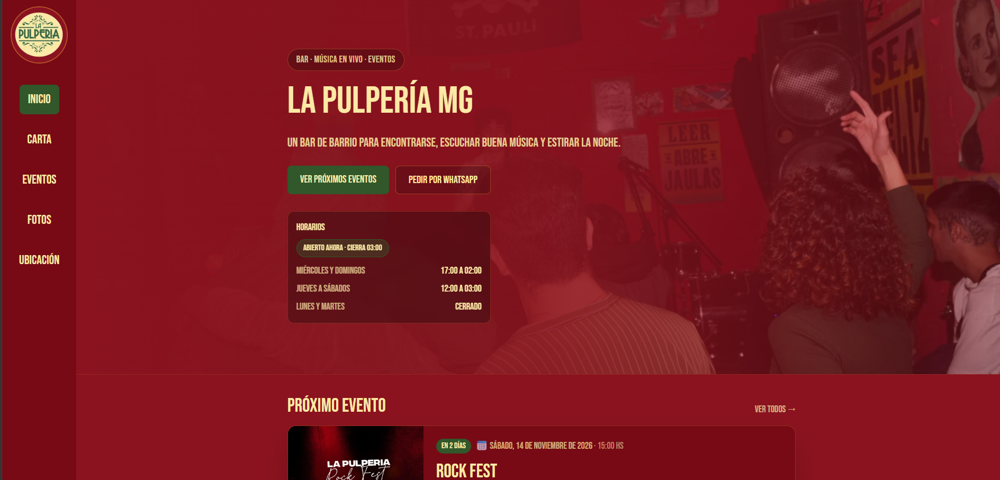
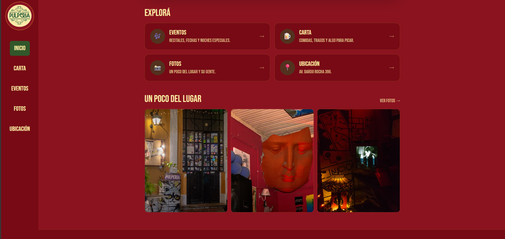
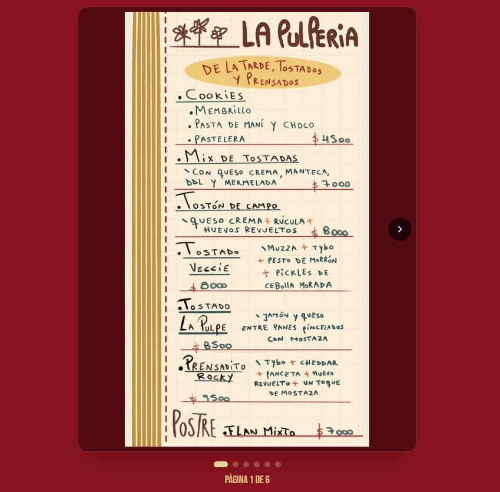
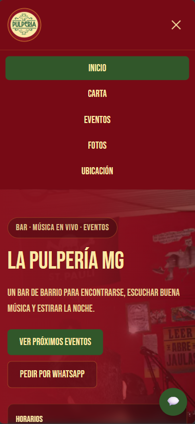
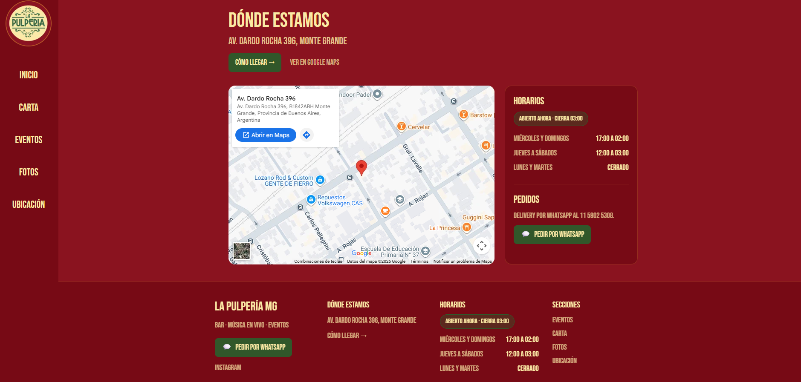

# La Pulpería MG

[](https://github.com/santiagomanganiello/lapulperia-mg/actions/workflows/ci.yml)

Sitio web del bar **La Pulpería MG**: carta, agenda de eventos, fotos y ubicación, con un panel de administración para publicar fechas sin tocar código.

Demo: [lapulperia-mg.vercel.app](https://lapulperia-mg.vercel.app/)

## Capturas





| Carta virtual                                                     | Mobile (390 px)                                                |
| ----------------------------------------------------------------- | -------------------------------------------------------------- |
|  |  |



## Stack

- **Astro 7** — páginas estáticas + rutas on-demand.
- **Tailwind CSS 4** — estilos.
- **Supabase** — base de datos de eventos, storage de flyers y autenticación del panel.
- **Vercel** — deploy, con ISR en la página de eventos.

## Arquitectura

| Ruta                                 | Renderizado                        | Motivo                                                                      |
| ------------------------------------ | ---------------------------------- | --------------------------------------------------------------------------- |
| `/`, `/carta`, `/fotos`, `/location` | Estático (prerender)               | Contenido que cambia poco: máxima velocidad.                                |
| `/eventos`                           | On-demand + **ISR (60 s)**         | Lee de Supabase y se revalida cada minuto sin redeploy.                     |
| `NextEvent` (home)                   | **Server island** (`server:defer`) | La home sigue estática y solo la tarjeta del próximo evento se pide aparte. |
| `/admin`, `/admin/login`             | Estático                           | Shell protegido por Supabase Auth; los datos, por RLS.                      |

Decisiones y por qué: ver [`docs/arquitectura.md`](docs/arquitectura.md).

Bitácora del proyecto (fase 0 a 3.8, con conceptos clave): [`docs/bitacora.md`](docs/bitacora.md) · [PDF de la fase 0 a 3.5](docs/bitacora.pdf).

## Cómo correrlo

```bash
npm install
cp .env.example .env   # completar con las claves de Supabase
npm run dev
```

Queda en `http://localhost:4321`.

> `npm run preview` no funciona con el adaptador de Vercel. Para ver el sitio en local usá `astro dev`.

### Variables de entorno

| Variable                   | Obligatoria | Descripción                                                                      |
| -------------------------- | ----------- | -------------------------------------------------------------------------------- |
| `PUBLIC_SUPABASE_URL`      | Sí          | URL del proyecto Supabase.                                                       |
| `PUBLIC_SUPABASE_ANON_KEY` | Sí          | Clave pública (publishable). Es segura en el cliente: el acceso lo controla RLS. |
| `SITE_URL`                 | No          | Dominio público. Si no está, se usa el de `astro.config.mjs`.                    |

### Base de datos

Ejecutar [`supabase-setup.sql`](supabase-setup.sql) en el SQL Editor de Supabase. Crea las políticas RLS, el bucket `flyers-pulpe` y deja listo el alta del usuario administrador (se crea desde el panel de Supabase, no por SQL).

## Scripts

| Comando                | Acción                                      |
| ---------------------- | ------------------------------------------- |
| `npm run dev`          | Servidor de desarrollo en `localhost:4321`. |
| `npm run build`        | Build de producción (`.vercel/output`).     |
| `npm run check`        | Verificación de tipos (`astro check`).      |
| `npm run lint`         | ESLint (TypeScript + Astro).                |
| `npm run lint:fix`     | ESLint con corrección automática.           |
| `npm test`             | Tests unitarios (Vitest).                   |
| `npm run test:watch`   | Tests unitarios en modo interactivo.        |
| `npm run test:e2e`     | Smoke E2E con Playwright.                   |
| `npm run format`       | Prettier sobre todo el repo.                |
| `npm run format:check` | Verifica el formato sin escribir.           |
| `npm run astro ...`    | CLI de Astro.                               |

### Tests

Los tests cubren la lógica que no se ve en pantalla y que es fácil de romper:

| Archivo                  | Qué prueba                                                                     |
| ------------------------ | ------------------------------------------------------------------------------ |
| `tests/hours.test.ts`    | Turnos que cruzan medianoche, estado abierto/cerrado y textos del badge.       |
| `tests/events.test.ts`   | Formato de fechas en `America/Argentina_Buenos_Aires` y etiquetas relativas.   |
| `tests/calendar.test.ts` | Generación del `.ics`: fechas UTC, duración, escapado y composición del texto. |

No se testean los textos ni el HTML: cambian seguido y no aportan señal.

### Tests E2E

Los smoke E2E abren Chromium de verdad y verifican lo que un test unitario no ve: que cada ruta pública cargue sin errores de JavaScript, que una URL inexistente devuelva 404, que los enlaces del menú respondan y que el menú mobile y los visores de fotos y carta se manejen con teclado.

```bash
npx playwright install chromium   # una vez por máquina
npm run test:e2e
```

Archivos: `tests/e2e/smoke.spec.ts` (rutas y enlaces) y `tests/e2e/a11y.spec.ts` (teclado y foco). Playwright levanta `astro dev` solo; no hace falta tenerlo corriendo.

### Integración continua

Cada push a `main` y cada pull request (incluidos los de Dependabot) corren en GitHub Actions, en dos jobs independientes:

```
quality: npm ci → check → lint → format:check → test → build
e2e:     npm ci → playwright install chromium → test:e2e
```

El workflow está en [`.github/workflows/ci.yml`](.github/workflows/ci.yml) y no necesita secretos: el build funciona aunque falten las variables de Supabase (el sitio degrada a agenda vacía).

## Estructura

```text
src/
├── assets/          imágenes fuente (optimizadas en build)
├── components/      NavBar, NextEvent, PhotoGallery, CartaVirtual, Location
├── layouts/         Layout público y AdminLayout
├── lib/             cliente de Supabase y utilidades de fechas
├── pages/           rutas del sitio y del admin
└── styles/          Tailwind + tipografía
supabase-setup.sql   esquema, políticas y bucket
tests/               unitarios (Vitest) y smoke E2E (Playwright)
```

## Panel de administración

`/admin` permite crear, editar, duplicar, publicar/despublicar y borrar eventos, subir flyers (se optimizan en el navegador antes de subirse) y exportar la lista a CSV. Se entra con un usuario de Supabase Auth (`/admin/login`).

Guía paso a paso: [`docs/manual-admin.md`](docs/manual-admin.md).

## Créditos

Código escrito para este proyecto. Las fotos, el logo y la identidad visual son propiedad de **La Pulpería MG** y se usan con autorización de sus dueños.
